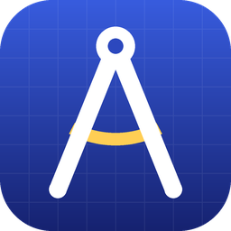

<p align="center"></p>

<h1 align="center">Architectus</h1>
<p align="center"><b>Type something rough. Get a master prompt.</b><br>
A free, open-source Windows app by <a href="https://opifexstudios.ca">Opifex Studios</a>.</p>

---

Type a rough request like *"help me write a cover letter for a barista job, I'm friendly and have 2 years experience"* and hit **Generate**. Architectus rewrites it into a structured, ready-to-paste prompt (role, context, task, requirements, output format, and placeholders for anything missing) that gets better results from ChatGPT, Claude, Gemini or any other AI.

## Features

- **Free with Google Gemini**: get a free key from [Google AI Studio](https://aistudio.google.com/apikey), no card needed.
- **Or bring your own key** for OpenAI or Anthropic (Claude) (these need prepaid API credit).
- **Streaming output**: watch the prompt appear word by word.
- **Model picker**: defaults to fast, cheap models (a prompt usually costs a fraction of a cent), or load the full list from your account.
- **Edit, copy, save**: tweak the result, copy it in one click, or keep it in your local library.
- **No servers, no accounts, no telemetry.** Requests go straight from your PC to the provider you pick.

## Download

**[Download Architectus-Setup.exe](https://github.com/arkbullet2626-droid/Architectus/releases/latest/download/Architectus-Setup.exe)** (always the latest version), or see [all releases](https://github.com/arkbullet2626-droid/Architectus/releases). Windows 10 (1809+) or Windows 11, 64-bit.

## How your API keys are stored

Keys are saved with the Windows Credential Manager API (`CredWrite`, generic credentials), which encrypts them with DPAPI for your Windows user account. They are never written to a settings file, log, or the library, and are only sent in the auth header to the provider you chose. See [`CredentialStore.cs`](src/Architectus/Services/CredentialStore.cs).

You can inspect or delete them any time in **Control Panel → Credential Manager → Windows Credentials** (entries named `Architectus:openai`, `Architectus:anthropic`, `Architectus:gemini`), from **Settings → Remove all keys** in the app, or by choosing to remove data when uninstalling.

Non-secret data lives in `%LOCALAPPDATA%\Architectus\` (`settings.json`, `library.json`).

## About the meta-prompt

Architectus wraps your rough text in hidden instructions (the *meta-prompt*) before sending it to the model.

- **Official releases** use Opifex Studios' tuned "Architect" meta-prompt. It isn't published in this repo; CI injects it from a repository secret at build time and stores it encrypted in the app.
- **Builds from source** use the open baseline meta-prompt in [`MetaPrompt.cs`](src/Architectus/Services/MetaPrompt.cs), and work fully.

To be upfront: the official meta-prompt is protected from casual copying, not hidden from a determined person. Because you call the AI with your own key, you can always see exactly what's sent from your PC. Nothing about your keys or data depends on that secret.

## Building from source

Requirements: Windows 10/11, .NET 8 SDK, and (for the installer) Inno Setup 6.

```powershell
dotnet publish src/Architectus/Architectus.csproj -c Release -r win-x64 -p:Platform=x64 --self-contained true -o publish
iscc /DSourceDir=..\publish installer\Architectus.iss   # optional: builds dist\Architectus-Setup-*.exe
```

Releases are built by GitHub Actions ([`build.yml`](.github/workflows/build.yml)) whenever a `v*` tag is pushed.

## License

MIT © 2026 Opifex Studios
